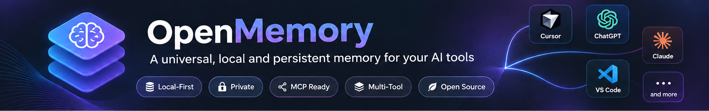
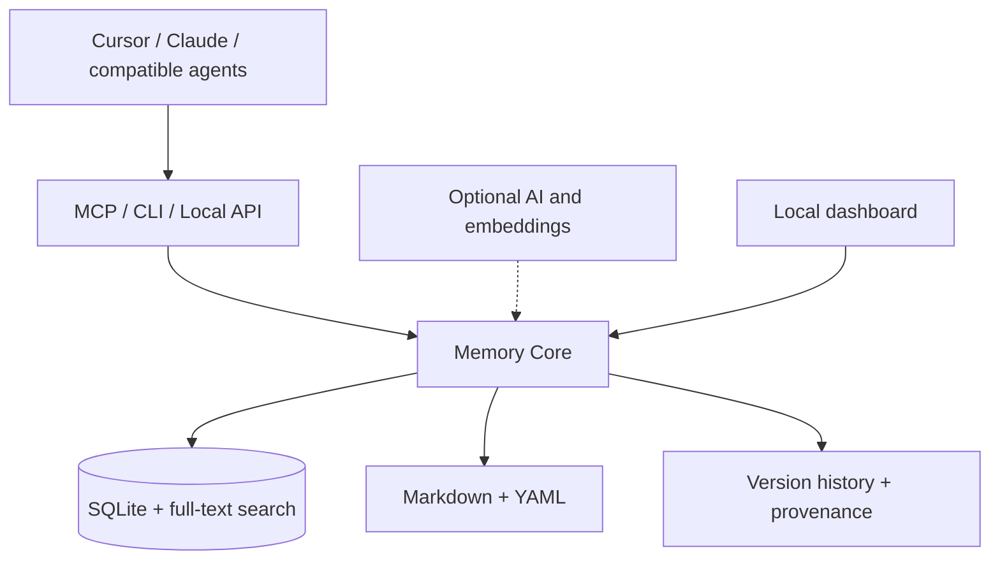

  

<h1 align="center">OpenMemory</h1>

<strong>One memory. Every AI tool. Your data.</strong>

A local-first, human-readable memory layer designed to give AI assistants and agents persistent, shared, source-aware knowledge.

  
  
  
  

> [!IMPORTANT]
> **Project status:** OpenMemory is under development. The architecture and features below describe the intended product, not functionality verified in a published release. Installation instructions and compatibility claims will be added once working builds are tested.

## Why OpenMemory?

AI tools can be brilliant at individual tasks but often lose context between sessions, repeat questions, and carry outdated or unsupported assumptions forward. OpenMemory aims to provide a **single, portable knowledge base** that compatible assistants can access without owning or locking away your data.

**Keep what matters. Preserve what changed. Know where it came from.**

## Planned capabilities

| Capability | What it means |
| --- | --- |
| **Shared memory** | One memory layer for compatible AI tools and agents. |
| **Local-first storage** | Keep data on your machine by default, without a required cloud account. |
| **Human-readable files** | Inspect and edit knowledge in Markdown with YAML metadata. |
| **Versioned knowledge** | Track corrections, historical states, and decisions instead of silently overwriting them. |
| **Source awareness** | Attach provenance and verification status to remembered claims. |
| **Conflict handling** | Detect and review competing statements without silently discarding evidence. |
| **Efficient retrieval** | Search by keyword and, optionally, meaning; return relevant context within token budgets. |
| **MCP integration** | Offer standard tools for compatible AI clients. |
| **Optional intelligence** | Add extraction and consolidation with local or explicitly configured external models. |
| **Portable backups** | Export, import, back up, and restore the knowledge base. |

## How it is designed to work

**SQLite** is intended to handle transactional state and indexing; **Markdown** provides a readable, portable representation. The system is designed to remain useful without an AI model, internet connection, or paid API key.

## Example use cases

- **Developers:** Keep architecture decisions, project constraints, and lessons learned available across sessions.
- **Multi-agent workflows:** Share relevant project knowledge between compatible agents while separating namespaces.
- **Personal knowledge:** Maintain an inspectable history of preferences, notes, and decisions.
- **Research:** Preserve sources and distinguish verified findings from hypotheses.

## Installation

**Coming with the first tested release.** The target experience is download → install → launch → connect a compatible client. Planned platforms are macOS, Windows, and Linux; availability will depend on completed builds and testing.

Developer setup and actual CLI commands will be documented when the implementation is available. No placeholder commands are presented as working instructions.

## Integrations

The initial integration target is **MCP**, with examples planned for Cursor and other compatible clients. ChatGPT and other applications may require different connection mechanisms depending on their supported capabilities. **MCP access does not automatically capture every conversation**: automatic ingestion requires explicit client cooperation or a dedicated integration.

## Data integrity and trust

OpenMemory is being designed around a few important rules:

1. **A claim is not proof.** Store its source and verification status.
2. **History matters.** Corrections preserve previous revisions unless the user explicitly deletes data.
3. **Conflicts are visible.** Never silently choose between incompatible claims.
4. **AI output is untrusted input.** Validate proposed memory changes before committing them.
5. **The user stays in control.** Make data inspection, export, and deletion straightforward.

These measures can reduce unsupported or outdated context, but they cannot guarantee hallucination-free AI output.

## Roadmap

- [ ] **Milestone 1 — Memory Core:** SQLite, Markdown, CRUD, revisions, full-text search, basic MCP tools, tests.
- [ ] **Milestone 2 — Intelligence:** Optional embeddings, extraction, duplicate detection, conflict review.
- [ ] **Milestone 3 — Interface:** Local dashboard, namespace management, source and history explorer.
- [ ] **Milestone 4 — Distribution:** Desktop installers, platform tests, backup/restore validation, documentation.

Progress checkboxes will be updated only after functionality is implemented and verified.

## Contributing

Contributions, design feedback, test cases, and integration ideas are welcome once the repository's contribution workflow is published. Please avoid submitting real private conversation histories or credentials in issues.

## Security and privacy

The intended default is local-only storage and loopback-only network services. External AI providers will be opt-in. Security controls, threat-model documentation, and a vulnerability reporting process will be published as the implementation matures.

## Licence

**To be selected before the first public code release.** An OSI-approved licence will be chosen after checking dependency compatibility; no licence is implied by this draft README.

---

<strong>OpenMemory</strong> Build once. Remember across tools. Stay in control.

